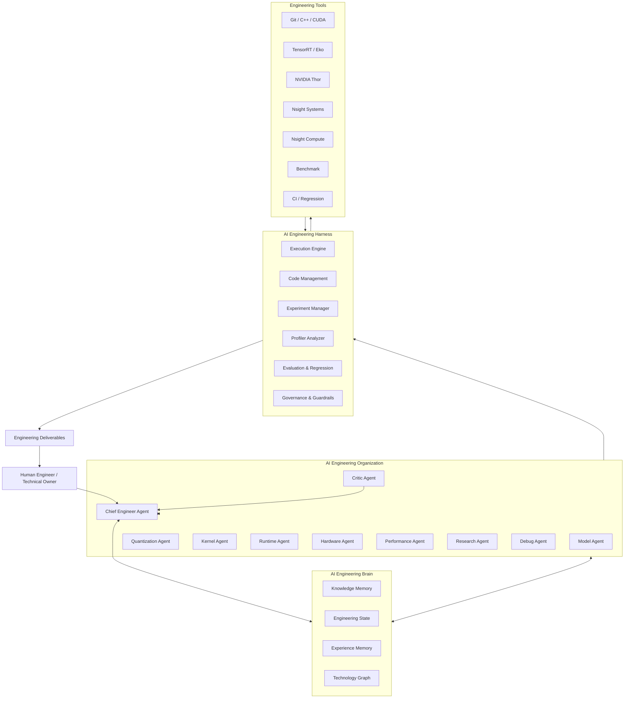
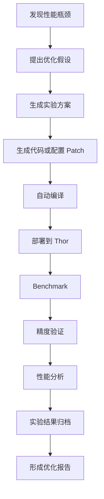
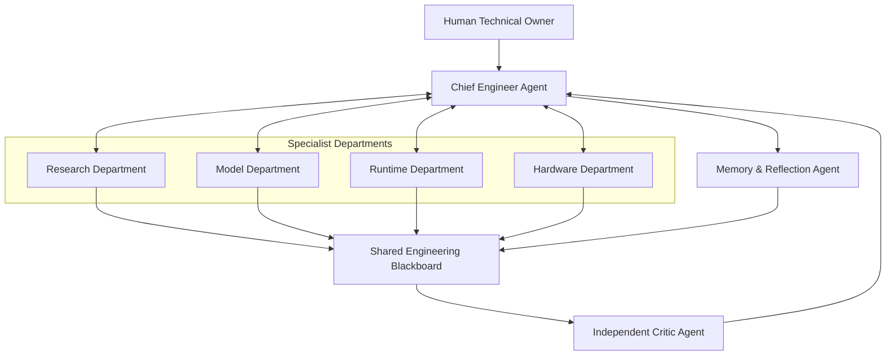
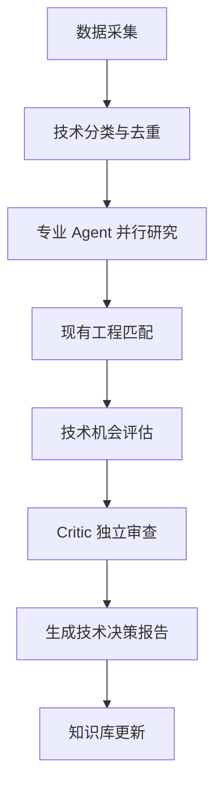
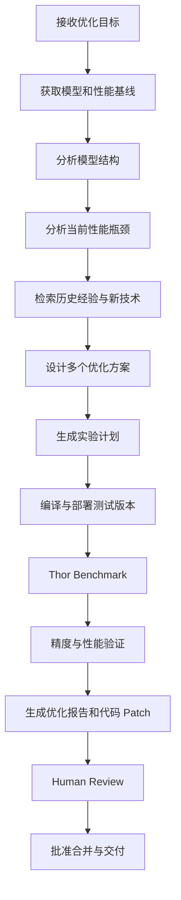

# 智驾模型部署 AI Engineering System 建设规划

> **文档定位：** 面向智驾模型部署与性能优化的 AI 工程体系建设方案  
> **核心目标：** 建立具备工程认知、专业分工、自主执行、实验验证和知识进化能力的 AI 技术团队。  
> **适用范围：** 两段式感知模型、决策模型、一端式 Vision-Action 模型（包含 Q-Former）及 NVIDIA Thor 车端部署环境。

---

# 1. 建设背景与目标

## 1.1 当前负责的技术领域

主要负责智驾模型车端部署与性能优化，涉及：

| 技术领域 | 主要工作内容 |
|---|---|
| 模型部署 | 两段式感知模型、决策模型、Vision-Action 模型 |
| 模型量化 | FP16、INT8、FP8、PTQ、QAT、混合精度、QDQ |
| 算子融合 | Conv、Attention、MLP、LayerNorm 等算子融合 |
| 算子优化 | CUDA Kernel、TensorRT Plugin、自定义算子 |
| 推理框架 | Eko、TensorRT、推理调度、Execution Context |
| 访存优化 | Memory Layout、Buffer 复用、数据搬运、内存带宽 |
| GPU 优化 | CUDA Graph、Stream、Kernel Launch、并发调度 |
| 硬件优化 | NVIDIA Thor、GPU、DLA、硬件编码及其他硬件引擎 |
| 性能分析 | Nsight Systems、Nsight Compute、Latency、资源利用率 |
| 工程交付 | 模型转换、编译、部署、精度验证、性能回归 |

当前工作涉及多个层次：

- 模型结构层：网络拓扑、计算量、算子组成。
- 模型优化层：量化、精度、计算图优化。
- 推理引擎层：TensorRT、Eko、Plugin、Runtime。
- GPU 执行层：CUDA Kernel、Memory、Stream、Graph。
- 硬件执行层：Thor GPU、DLA、硬件加速引擎。
- 工程交付层：自动化部署、性能测试、精度回归。

## 1.2 建设目标

建设一套面向智驾模型部署的 AI Engineering System，使 AI 能够：

1. 持续理解当前负责的模型结构、量化方案、推理框架和硬件环境。
2. 自动分析模型结构变化及其对部署和性能的影响。
3. 自动分析量化方案及其精度、性能和资源表现。
4. 自动分析 Thor 上的模型运行性能，定位瓶颈。
5. 持续跟踪行业技术进展，识别可应用的新技术。
6. 主动发现模型部署和推理优化机会。
7. 自动设计优化实验、执行 Benchmark、验证优化效果。
8. 沉淀历史问题、解决方案和技术经验。
9. 通过多 Agent 协作完成复杂技术任务。
10. 逐步形成可以自主研究、自主实验、自主验证的 AI 技术团队。

核心目标不是让 AI 帮助编写更多代码，而是让 AI 能够完成一轮完整的工程优化闭环。

---

# 2. 总体架构设计

建议将系统划分为三个核心层次：

1. AI Engineering Brain：工程知识与状态管理。
2. AI Engineering Organization：专业 Agent 组织与协作。
3. AI Engineering Harness：工具执行、实验管理与结果验证。

## 2.1 系统总体架构



## 2.2 三个核心层次的职责

### A. Engineering Brain：理解工程

负责统一管理：

- 模型结构。
- 模型版本。
- 量化方案。
- 推理引擎。
- 硬件环境。
- 性能基线。
- 精度数据。
- Profiler 数据。
- 历史问题。
- 优化实验。
- 行业技术资料。
- 技术决策记录。

核心价值：让 AI 具备持续、准确的工程认知，而不是每次任务都从零开始。

### B. Engineering Organization：研究工程

通过专业 Agent 分工，实现：

- 模型分析。
- 量化分析。
- 算子分析。
- 推理框架分析。
- 硬件性能分析。
- 行业技术研究。
- 问题排查。
- 优化方案设计。
- 技术决策与反方审查。

核心价值：让 AI 形成专业化的技术协作团队。

### C. Engineering Harness：执行工程

提供确定性的工程执行能力：

- 代码读取与修改。
- 编译和部署。
- 模型解析。
- TensorRT Engine 分析。
- Thor 远程执行。
- Nsight 数据解析。
- Benchmark。
- 精度回归。
- 性能回归。
- 实验记录。

核心价值：让 AI 能够把技术建议转化为可验证的工程结果。

---

# 3. AI Engineering Brain：工程知识与状态管理

这是整个系统最重要的基础设施。

建议建设统一的 Engineering Knowledge Base 和 Engineering State Database。

## 3.1 模型部署全生命周期数字档案

为每个模型建立独立的 Model Profile。

建议包含以下信息：

| 分类 | 具体内容 |
|---|---|
| 模型基本信息 | 模型名称、版本、业务类型 |
| 模型结构 | Backbone、Neck、Head、Attention、Q-Former |
| 模型规模 | 参数量、MACs、FLOPs、激活量 |
| 算子信息 | 算子数量、算子类型、计算图拓扑 |
| 数据类型 | FP32、FP16、BF16、INT8、FP8 |
| 量化方案 | PTQ、QAT、校准数据、QDQ、混合精度 |
| Runtime | TensorRT、Eko、Execution Context、CUDA Graph |
| 硬件信息 | Thor 型号、GPU、DLA、内存 |
| 性能指标 | Latency、FPS、显存、带宽、GPU 利用率 |
| 精度指标 | 原始精度、量化精度、任务指标变化 |
| 版本信息 | 模型版本、代码 Commit、Engine 版本、编译参数 |

### 核心能力

任意两个模型版本、量化方案和 Runtime 版本之间，都能够自动进行差异分析。

典型问题：

- 模型更新增加了哪些计算量？
- 哪些算子发生变化？
- 为什么 INT8 版本只比 FP16 快了 8%？
- 哪些 Attention 层不适合 INT8？
- Q-Former 增加的计算量来自 Attention、MLP，还是数据搬运？
- TensorRT 版本升级为什么导致 Latency 变化？
- 哪些算子出现了额外的 Reformat 开销？

## 3.2 Engineering State：当前工程状态

知识库不应该只保存文档，还应该记录当前真实工程状态。

例如：

```yaml
model:
  name: VisionAction_V3
  version: V3
  type: vision_action

quantization:
  method: INT8
  strategy: mixed_precision
  calibration_dataset: dataset_v3

runtime:
  engine: TensorRT
  engine_version: "10.x"
  custom_plugins:
    - attention_plugin

hardware:
  platform: NVIDIA Thor
  gpu_architecture: Blackwell

performance:
  latency_ms: null
  fps: null
  memory_mb: null

accuracy:
  baseline: null
  quantized: null

status:
  deployment: in_progress
  validation: pending
```

上述数据为 Schema 示例，实际数值需要从工程环境中采集。

## 3.3 Experience Memory：历史工程经验

每次完成技术任务，都应该沉淀：

- 问题描述。
- 环境信息。
- 根因分析。
- 验证过程。
- 最终解决方案。
- 失败的尝试。
- 相关代码和 Commit。
- 适用条件。
- 后续注意事项。

特别需要记录失败实验，避免重复试错。

## 3.4 Technology Graph：技术关联图谱

建立模型、算子、量化、Runtime、硬件之间的关联关系。

例如：

```text
VisionAction_V3
    |
    +-- Q-Former
    |     |
    |     +-- Cross Attention
    |     +-- MLP
    |     +-- LayerNorm
    |
    +-- Quantization
    |     |
    |     +-- INT8
    |     +-- FP16
    |
    +-- TensorRT
    |     |
    |     +-- Attention Plugin
    |     +-- Reformat
    |
    +-- NVIDIA Thor
          |
          +-- CUDA Kernel
          +-- GPU Memory
          +-- CUDA Graph
```

通过技术图谱，AI 可以分析某项技术变化会影响哪些模型和部署模块。

---

# 4. AI Engineering Organization：专业 Agent 体系

建议建设以下 10 个专业 Agent。

## 4.1 Model Agent：模型结构分析

主要职责：

- 解析 ONNX、计算图和网络结构。
- 分析参数量、FLOPs、MACs。
- 识别新增和删除的算子。
- 分析模型版本差异。
- 识别动态 Shape。
- 识别不支持的算子。
- 分析模型结构变化对部署的影响。

典型任务：

算法团队更新 Vision-Action 模型并引入 Q-Former，自动分析其计算结构、算子支持、量化风险和部署影响。

## 4.2 Quantization Agent：量化分析

主要职责：

- 分析 Weight / Activation Distribution。
- 分析 Layer-wise Quantization Sensitivity。
- 分析校准数据。
- 分析 QDQ 节点和算子映射。
- 制定混合精度策略。
- 比较 INT8、FP8、FP16 等方案。
- 分析量化引入的 Reformat 和 Cast 开销。
- 评估精度与性能收益。

核心目标：

综合精度敏感度、算子硬件支持和实际运行性能，给出逐层量化建议。

## 4.3 Kernel Agent：算子优化

主要职责：

- CUDA Kernel 分析。
- TensorRT Plugin 分析。
- 算子融合建议。
- Memory Layout 优化。
- Tile、Block、Warp 优化。
- Tensor Core 利用率分析。
- Kernel Fusion。
- 算子性能对比。

核心目标：

发现重复算子、低效算子和可复用的底层 Kernel。

## 4.4 Runtime Agent：推理框架优化

主要职责：

- TensorRT Engine 分析。
- Eko Runtime 分析。
- Execution Context 管理。
- CUDA Graph 优化。
- Stream 调度。
- Buffer 生命周期分析。
- Kernel Launch 开销分析。
- 多模型调度优化。

核心目标：

从推理引擎层降低调度开销、数据转换开销和资源管理开销。

## 4.5 Hardware Agent：硬件性能分析

主要职责：

- Thor GPU 架构分析。
- GPU Memory 带宽分析。
- Tensor Core 利用率分析。
- DLA 适用性分析。
- CUDA 异步执行分析。
- 硬件引擎调用分析。
- 编码引擎及跨引擎同步分析。
- 不同硬件平台性能差异分析。

核心目标：

将模型和 Runtime 的执行行为与实际硬件特性建立联系。

## 4.6 Performance Agent：性能瓶颈诊断

主要职责：

- 解析 Nsight Systems。
- 解析 Nsight Compute。
- 分析 TensorRT Layer Profile。
- 识别 Compute Bound。
- 识别 Memory Bound。
- 分析 Kernel Launch。
- 分析 Stream Synchronization。
- 识别数据搬运和 Reformat 开销。

典型输出：

- 模型整体耗时分布。
- 各层耗时分布。
- Kernel 耗时排名。
- GPU 资源利用率。
- 访存效率。
- 性能瓶颈排序。
- 优化建议及证据。

## 4.7 Research Agent：行业技术研究

主要职责：

- 跟踪学术论文。
- 跟踪 NVIDIA 官方文档。
- 跟踪 GitHub 项目。
- 跟踪主流推理框架。
- 跟踪量化技术。
- 跟踪模型架构。
- 跟踪算子优化技术。
- 跟踪车端部署实践。

重点研究方向：

| 研究方向 | 重点内容 |
|---|---|
| 模型架构 | BEV、Transformer、Sparse Attention、Vision-Action、Q-Former |
| 量化技术 | PTQ、QAT、FP8、INT8、混合精度 |
| 算子技术 | Attention、GEMM、Conv、LayerNorm、Kernel Fusion |
| 推理引擎 | TensorRT、CUDA Graph、Kernel Scheduling |
| 硬件优化 | Thor、Tensor Core、DLA、GPU Memory |
| 工程实践 | 自动化 Benchmark、部署流水线、回归测试 |

## 4.8 Debug Agent：复杂问题排查

主要职责：

- C++ / CUDA 源码分析。
- 编译日志分析。
- 运行日志分析。
- NVIDIA 官方文档检索。
- 问题假设生成。
- 实验设计。
- 根因验证。
- 历史问题匹配。

典型问题：

- CUDA 异步拷贝导致内存覆盖。
- 跨 Stream 同步问题。
- TensorRT Plugin 数据布局异常。
- CUDA Graph Capture 失败。
- Thor 硬件编码串图。
- GPU Buffer 生命周期错误。
- 不同 GPU 架构表现不一致。

建议增加 Challenger Agent，负责反向验证主 Debug Agent 的根因假设，避免过早确定结论。

## 4.9 Critic Agent：独立审查

主要职责：

- 检查技术结论。
- 检查证据是否充分。
- 寻找反例。
- 审查技术建议。
- 评估风险。
- 识别过度推断。
- 评估实验是否足以支持结论。

核心原则：

任何重要技术结论，都应该具备可追溯的证据，而不是只依赖 LLM 的常识。

## 4.10 Memory & Reflection Agent：经验沉淀

主要职责：

- 整理任务执行记录。
- 总结解决方案。
- 记录失败实验。
- 更新知识库。
- 更新模型 Profile。
- 建立问题关联。
- 识别可复用的优化经验。
- 生成长期技术演进记录。

---

# 5. 重点建设的 AI Engineering 项目

除了每周技术情报分析，建议重点建设以下项目。

## 5.1 自动性能分析与瓶颈诊断系统

优先级：P0

### 建设目标

自动完成：

1. 收集模型运行数据。
2. 解析 TensorRT Profile。
3. 解析 Nsight Systems。
4. 解析 Nsight Compute。
5. 将 Kernel 映射到模型层。
6. 分析计算、访存、Launch、同步瓶颈。
7. 生成优化建议。

### 主要 Agent

- Profiler Agent
- Bottleneck Agent
- Model Mapping Agent
- Optimization Agent
- Critic Agent

### 典型输出

```text
Model: VisionAction_V3
Hardware: NVIDIA Thor
Runtime: TensorRT

Total Latency: 12.6 ms

Performance Breakdown:
  Attention: 36%
  Memory Copy / Reformat: 24%
  MLP: 20%
  Other Operators: 12%
  Launch / Sync: 8%

Optimization Opportunities:
  1. Attention Memory Optimization
  2. Reformat Elimination
  3. CUDA Graph Optimization
  4. Stream Synchronization Optimization
```

以上为示例数据。

## 5.2 自动优化实验系统（Optimization Lab）

优先级：P0

### 建设目标

让 AI 不仅提出优化建议，还能够自动设计、执行和验证优化实验。

工作流程：



### 实验方向

| 实验编号 | 优化方向 | 实验变量 |
|---|---|---|
| EXP-001 | Kernel Fusion | 融合前后 |
| EXP-002 | Memory Layout | NCHW / NHWC / HWC16 |
| EXP-003 | Quantization | INT8 / FP8 / FP16 |
| EXP-004 | CUDA Graph | Enable / Disable |
| EXP-005 | Memory Reuse | Buffer 复用策略 |
| EXP-006 | Kernel Optimization | Block / Warp / Tile |

### 实验管理要求

每次实验必须记录：

- Model Version。
- Code Commit。
- Engine Version。
- Quantization Config。
- Hardware Environment。
- Build Config。
- Benchmark Config。
- Accuracy Result。
- Latency Result。
- Memory Result。
- Profiler Artifact。

初期只允许 AI 自动执行测试、编译和 Benchmark。生产代码合并、Engine 发布和正式车端部署必须经过人工审批。

## 5.3 模型结构变化影响分析系统

优先级：P0

### 建设目标

当算法模型更新时，自动分析变化对部署工作的影响。

分析内容：

- 新增和删除的计算节点。
- 参数量和 FLOPs 变化。
- 激活内存变化。
- 算子支持情况。
- TensorRT Plugin 需求。
- Dynamic Shape 变化。
- Memory Layout 变化。
- 精度约束变化。
- CUDA Graph 适用性。
- 数据传输开销。

例如：

新增 Q-Former 后，自动分析：

- Cross-Attention。
- MLP。
- LayerNorm。
- KV / Feature Memory。
- Transpose。
- Softmax。
- Attention 量化敏感性。

输出部署风险和待验证项目。

## 5.4 量化方案智能分析系统

优先级：P1

### 建设目标

建立模型结构和量化策略之间的关联。

核心功能：

- Layer-wise Quantization Sensitivity。
- Activation / Weight Distribution。
- Calibration Dataset 分析。
- QDQ 节点分析。
- TensorRT Precision Assignment。
- 混合精度策略推荐。
- 量化精度损失分析。
- 量化后实际性能收益分析。

核心原则：

量化优化不能只看精度损失，还要看量化后的实际 Kernel 是否更快，以及是否增加 Reformat、Cast 等开销。

## 5.5 行业技术情报与技术机会发现系统

优先级：P1

### 建设目标

实现：

行业技术发现 → 原理解析 → 工程匹配 → 可应用性评价 → PoC 计划。

每项技术必须回答：

1. 解决什么问题？
2. 核心原理是什么？
3. 与 Eko / TensorRT / Thor 有什么关系？
4. 是否能够直接应用？
5. 需要多少改造成本？
6. 值不值得投入 PoC？

技术机会评级：

| 级别 | 定义 |
|---|---|
| A | 可以直接应用，建议立即验证 |
| B | 需要改造，建议安排 PoC |
| C | 技术有价值，但短期不适合 |
| D | 与现有工程关联较弱 |

## 5.6 自动技术问题排查系统

优先级：P1

面向复杂 CUDA、TensorRT、Thor 问题。

核心流程：

```text
问题输入
    ↓
代码与日志收集
    ↓
历史问题检索
    ↓
生成多个根因假设
    ↓
专业 Agent 独立分析
    ↓
设计验证实验
    ↓
执行实验
    ↓
Challenger 反向验证
    ↓
根因确认
    ↓
沉淀解决方案
```

重要要求：

- 根因必须区分事实、推断和假设。
- 重要结论必须有证据。
- 不允许只给出单一未经验证的解释。
- 必须记录排除掉的其他假设。

## 5.7 技术决策与团队协作系统

优先级：P2

核心功能：

- 需求自动整理。
- 技术任务拆分。
- 研发进展汇总。
- 代码 Review 辅助。
- 技术方案比较。
- 风险分析。
- 周版本交付检查。
- 技术决策记录（ADR）。

最终自动生成：

- 技术周报。
- 项目进展。
- 风险清单。
- 问题清单。
- 下周计划。
- 技术决策记录。

## 5.8 AI 性能优化研究员

优先级：P2

定位：主动寻找跨模型、跨算子和跨硬件平台的优化机会。

例如：

- 多个模型存在重复 Attention 实现。
- 多个模型存在相同的 Reformat 开销。
- 某类算子在 Thor 上存在访存瓶颈。
- 多个 TensorRT Plugin 存在重复代码。
- 某些模型可以共享统一 Kernel。
- 某些 Buffer 管理逻辑可以统一优化。

目标是从单个模型优化上升到平台级优化。

## 5.9 Engineering Evolution：工程知识自进化

优先级：P2

每次任务结束后，自动进行 Reflection：

- 问题根因是什么？
- 哪些工具最有效？
- 哪些假设是错误的？
- 哪些优化被证明有效？
- 是否形成可复用代码？
- 是否需要更新知识库？
- 是否需要增加自动化测试？

形成：

工程问题 → 分析 → 实验 → 解决方案 → 经验沉淀 → 下一次更快解决。

---

# 6. Multi-Agent 协同模式

推荐采用：

**Supervisor + Specialist Agents + Independent Critic + Shared Blackboard**

## 6.1 Agent 组织结构



## 6.2 Agent 必须定义六个维度

| 维度 | 定义 |
|---|---|
| Role | 角色和职责 |
| I/O Contract | 输入输出数据结构 |
| Capabilities | 可以使用的工具 |
| Collaboration | 与哪些 Agent 协作 |
| State & Memory | 拥有什么状态和记忆 |
| Governance | 权限边界和验证要求 |

## 6.3 Agent 之间使用结构化数据通信

不要只传递自然语言。

例如 Performance Agent 向 Optimization Agent 传递：

```json
{
  "model": "VisionAction_V3",
  "hardware": "NVIDIA Thor",
  "runtime": "TensorRT",
  "bottleneck": {
    "operator": "Attention",
    "latency_ms": 2.4,
    "memory_bound": true,
    "evidence": [
      "nsys_profile",
      "kernel_metrics"
    ]
  },
  "optimization_targets": [
    "memory_access",
    "kernel_fusion",
    "layout_conversion"
  ],
  "constraints": {
    "accuracy_regression": "not_allowed",
    "deployment_platform": "Thor"
  }
}
```

以上为通信协议示例。

## 6.4 不同任务采用不同协作模式

| 任务 | 推荐协作方式 |
|---|---|
| 每周行业技术分析 | 并行 Research → 汇总 → Critic |
| 模型结构分析 | Model → Quantization / Runtime → Critic |
| 性能瓶颈分析 | Profiler → Performance → Optimization |
| 复杂 Bug 排查 | Debug → 多假设并行验证 → Challenger |
| 算子自动优化 | Optimization → 编译执行 → Benchmark → Evaluator |
| 技术方案决策 | 多专家独立分析 → Debate → Chief Engineer |

原则：不要让所有 Agent 参与所有任务。

---

# 7. Engineering Harness：工程执行与验证系统

Harness 应该独立于 Agent Prompt，提供确定性的工具接口。

## 7.1 核心模块

| 模块 | 主要职责 |
|---|---|
| Execution Engine | Shell、Python、C++、SSH 执行 |
| Code Management | Git、Diff、Patch、Review |
| Experiment Manager | 实验配置、执行、比较 |
| Observability | Trace、日志、运行状态 |
| Guardrails | 权限、审批、环境隔离 |
| Evaluation | 精度、性能、任务成功率 |

## 7.2 推荐工具接口

| 工具接口 | 功能 |
|---|---|
| `model.inspect()` | 解析 ONNX、计算图 |
| `model.diff()` | 比较模型版本 |
| `quant.analyze()` | 量化分析 |
| `trt.inspect()` | 解析 TensorRT Engine 和 Layer 信息 |
| `thor.deploy()` | 部署测试版本到 Thor |
| `thor.benchmark()` | 执行性能测试 |
| `nsys.analyze()` | 解析 Nsight Systems |
| `ncu.analyze()` | 解析 Nsight Compute |
| `code.search()` | 搜索 C++ / CUDA 源码 |
| `code.diff()` | 对比代码变化 |
| `experiment.run()` | 执行实验 |
| `experiment.compare()` | 比较实验结果 |
| `knowledge.update()` | 更新工程知识库 |

这些工具接口应尽可能通过确定性的 Python / C++ 程序实现，而不是让 LLM 自己推测如何操作系统。

## 7.3 统一实验数据库

建议采用：

- PostgreSQL：结构化数据。
- pgvector：向量化知识检索。
- 对象存储或文件系统：Profiler、Engine、模型文件及实验产物。

建议包含以下实体：

```text
Model
ModelVersion
QuantizationConfig
Engine
Hardware
Benchmark
ProfilerTrace
Experiment
Optimization
Bug
TechnicalDocument
TechnicalDecision
```

### 实验数据 Schema

```text
Experiment ID
    ├── Model Version
    ├── Model Checksum
    ├── Code Commit
    ├── Engine Version
    ├── Quantization Config
    ├── Thor Environment
    ├── Build Config
    ├── Benchmark Config
    ├── Accuracy Result
    ├── Latency Result
    ├── Memory Result
    └── Profiler Artifact
```

未来可以直接查询：

- 过去三个月，哪种 INT8 方案在 Thor 上综合性能最好？
- 哪些优化在 RTX 4000 上有效，但是在 Thor 上无效？
- 哪些模型存在重复的 Attention Kernel？
- 哪次 Engine 升级导致性能退化？
- 哪些算子优化产生了实际收益？

## 7.4 与现有基础设施结合

建议在现有 DGX Spark、SGLang、OpenClaw 环境基础上扩展。

| 层级 | 推荐技术 | 用途 |
|---|---|---|
| 入口与主动调度 | OpenClaw | Feishu、任务入口、定时触发 |
| 工作流编排 | LangGraph | 状态机、条件分支、重试 |
| 专业 Agent | Python Agent / OpenAI Agents SDK | 专业角色、工具调用 |
| 本地推理 | SGLang | 本地模型推理 |
| 云端推理 | OpenAI API | 复杂推理和交叉审查 |
| 知识库 | PostgreSQL + pgvector | 结构化数据和语义检索 |
| 实验执行 | Python + Shell + SSH | 编译、部署、Benchmark |
| 版本管理 | Git | 代码和配置版本 |
| 监控 | Trace + 实验日志 | 执行记录和评估 |

技术职责：

- OpenClaw：外部入口、主动任务触发、工具接入。
- LangGraph：复杂工程工作流、状态管理、条件分支。
- SGLang：本地模型推理。
- Python Harness：确定性工具执行。
- PostgreSQL：统一工程数据管理。

不建议让 OpenClaw、LangGraph 和 Agent 框架承担相同职责。

---

# 8. Weekly Engineering Intelligence：每周技术分析系统

## 8.1 建设目标

每周自动执行一次：

业务模型结构 → 当前量化方案 → Thor 运行性能 → 行业技术新资讯 → 技术适用性分析 → 优化建议。

不仅仅是 RSS 聚合和新闻总结，而是形成完整的技术机会发现流程。

## 8.2 每周工作流



## 8.3 研究方向

| 研究方向 | 重点追踪内容 |
|---|---|
| 模型架构 | ResNet、CNN-Transformer、BEVFormer、BEVDet、BEVDepth、BEVFusion、SparseBEV、StreamPETR、Vision-Action、Q-Former |
| 量化技术 | PTQ、QAT、FP8、INT8、低比特量化、混合精度 |
| 算子技术 | Attention、GEMM、Conv、LayerNorm、算子融合 |
| 推理引擎 | TensorRT、CUDA Graph、Kernel Scheduling、Memory Management |
| 硬件优化 | Thor、Tensor Core、DLA、GPU Memory、硬件编码 |
| 工程实践 | 编译优化、自动化 Benchmark、部署流水线、模型回归 |

## 8.4 技术机会评估

每项新技术必须回答：

1. 技术解决什么问题？
2. 核心原理是什么？
3. 与现有工程有什么关系？
4. 是否可以直接应用？
5. 需要多少改造成本？
6. 值不值得投入 PoC？

建议建立 Technology Opportunity Score：

```text
S = 0.30V + 0.25F + 0.20C + 0.15R + 0.10E
```

其中：

- V：潜在性能收益。
- F：现有工程匹配度。
- C：实施可行性。
- R：技术成熟度。
- E：证据可信度。

各项归一化为 0～100 分。

该分数用于辅助排序，不能代替实际 Benchmark。

## 8.5 周报输出结构

建议每周固定输出四部分：

### 第一部分：行业技术进展

过去一周值得关注的新技术、论文、项目和工程实践。

### 第二部分：现有工程影响

分析与以下内容的关联：

- 两段式感知模型。
- 决策模型。
- Vision-Action / Q-Former。
- 当前量化方案。
- Eko。
- TensorRT。
- NVIDIA Thor。

### 第三部分：技术机会清单

| 技术方向 | 预期收益 | 改造成本 | 机会等级 |
|---|---|---|---|
| 技术 A | 待评估 | 待评估 | A/B/C/D |
| 技术 B | 待评估 | 待评估 | A/B/C/D |

### 第四部分：下周行动建议

最多选择 3 个值得投入 PoC 的技术方向。

---

# 9. AI Agent Evaluation：评估体系

必须为每个 Agent 建立测试集。

| Agent | 评估指标 |
|---|---|
| Model Agent | 模型结构解析准确率 |
| Quantization Agent | 量化建议有效率、精度判断准确率 |
| Performance Agent | 性能瓶颈识别准确率 |
| Debug Agent | 根因定位准确率 |
| Research Agent | 技术事实准确率、来源可靠性 |
| Optimization Agent | 实验成功率、实际性能收益 |

需要特别区分：

- 技术建议是否合理。
- 实验是否执行成功。
- 性能是否真正提升。
- 精度是否满足要求。
- 结论是否可以复现。

建议使用 Trace 和 Evals 记录 Agent 的执行过程，而不只是评价最终回答。

---

# 10. 分阶段实施路线

建议分四个阶段。

## Phase 1：建立 Engineering Brain

预计周期：2～3 周。

建设内容：

- 模型 Profile。
- 量化方案档案。
- Thor 性能基线数据库。
- Eko / TensorRT 工程知识库。
- 历史问题库。
- 行业技术资讯采集。

阶段目标：

AI 能够准确理解当前负责的工程。

## Phase 2：建设专业 Agent

预计周期：3～5 周。

建设内容：

- Research Agent。
- Model Agent。
- Quantization Agent。
- Performance Agent。
- Runtime Agent。
- Hardware Agent。
- Critic Agent。

阶段目标：

自动完成每周技术分析和工程影响评估。

## Phase 3：建设 Engineering Harness

预计周期：4～6 周。

建设内容：

- 自动解析模型。
- 自动解析 Profiler。
- 自动运行 Thor Benchmark。
- 自动比较实验。
- 自动生成优化报告。
- 建立精度与性能回归机制。

阶段目标：

从 AI 分析升级到 AI 执行和验证。

## Phase 4：自主优化与知识进化

持续演进。

建设内容：

- 自动发现优化机会。
- 自动设计优化实验。
- 自动执行和验证。
- 自动沉淀工程经验。
- 建立长期技术演进路线。

阶段目标：

AI 从辅助工程师升级为自主技术研究助手。

---

# 11. 最终愿景：自主完成一轮工程优化闭环

整个系统最终应该支持如下工作模式。

输入任务：

> Vision-Action 模型在 NVIDIA Thor 上的推理延迟需要降低 15%，精度不能下降。

系统自动完成：



AI 最终交付：

1. 当前性能瓶颈分析。
2. 多个优化方案及其优先级。
3. 实验执行记录。
4. 优化前后性能对比。
5. 精度变化分析。
6. Profiler 证据。
7. 代码 Patch。
8. 优化结论及适用条件。

正式代码合并和生产环境部署仍由技术负责人审批。

---

# 12. 建设优先级与最终建议

如果从技术负责人角度考虑，我建议把所有项目归纳成三个核心系统。

| 核心系统 | 目标 | 关键能力 |
|---|---|---|
| AI Engineering Brain | 理解工程 | 模型、量化、算子、Runtime、硬件、历史经验 |
| AI Engineering Organization | 研究工程 | 多 Agent 分工、技术研究、问题诊断、方案设计 |
| AI Engineering Harness | 执行工程 | 编译、部署、Benchmark、Profiler、回归测试 |

第一阶段最值得优先建设的三个项目：

| 优先级 | 项目 | 核心价值 |
|---|---|---|
| P0 | Engineering Brain + 模型数字档案 | 建立统一工程认知 |
| P0 | 自动性能分析与瓶颈诊断 | 直接减少人工性能分析工作 |
| P0 | Optimization Lab | 让 AI 开始自动执行优化实验 |
| P1 | 模型结构变化分析 | 提前识别部署风险 |
| P1 | 量化分析 Agent | 提升量化决策效率 |
| P1 | Weekly Engineering Intelligence | 持续发现行业技术机会 |
| P1 | Debug Agent | 提升复杂问题排查效率 |
| P2 | 技术决策与团队协作 | 减少管理成本 |
| P2 | AI 性能优化研究员 | 主动发现跨模型优化机会 |
| P2 | Engineering Evolution | 建立长期工程复利 |

## 最核心的建设原则

1. 先建立工程知识和状态，再建设专业 Agent。
2. 先使用确定性工具，再让 Agent 自主调用工具。
3. Agent 之间使用结构化数据通信。
4. 重要技术结论必须有证据。
5. 优化结果必须经过实际 Benchmark。
6. 精度、性能和资源必须联合评估。
7. 失败实验同样需要记录和沉淀。
8. 生产环境修改必须有人类审批。
9. 每个 Agent 都需要独立评估。
10. 让系统随着工程任务的完成不断积累经验。

**最终目标：建设一个理解智驾模型部署、熟悉 NVIDIA Thor、掌握量化与算子优化、能够自主研究和执行工程实验的 AI 技术组织。**

它不只是一个技术问答系统，而是一个可以长期陪伴技术负责人、持续参与模型部署与性能优化的 AI Engineering Team。
