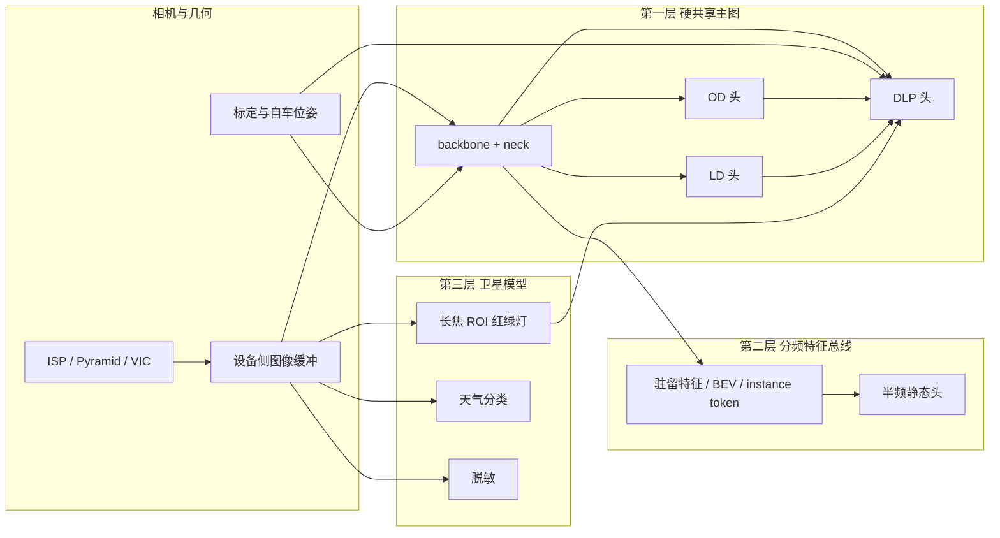

# 自动驾驶多模型部署编排与高性能推理

本文回答一个量产感知栈里反复出现的问题：车上同时存在 backbone、动目标检测（OD）、静态车道线（LD）、规划网络（DLP），以及红绿灯、脱敏、天气等卫星模型时，行业如何把它们编排成一条高确定、低延迟的推理链路。重点覆盖四件事：共享哪些上下文、共享的 prefill 输入输出如何定契约、量化如何分层、模型转换时编译器能优化什么、运行时又必须把什么留在图外。

文档区分两类表述。

- **公开资料**：NVIDIA、地平线、Apollo、TIER IV、TensorRT / Edge-LLM 文档或论文中能核对的机制与数字。
- **工程归纳**：多家方案收敛出的分层做法。它解释“为什么这样拆”，不代表某一家 OEM 的冻结配置，也不能写成全行业统一比例。

文内帧率、精度是**工程常见区间**，用来做预算，不是某款车的规格。

---

## 1. 先定边界：哪些模型该合成一张图

把下列模型放在同一张表里，才能看出它们根本不是同一类负载。

| 模型 | 典型输入域 | 常见帧率 | 输出消费者 | 失败的直接后果 |
|------|------------|----------|------------|----------------|
| backbone + neck | 环视多相机，已缩放到固定分辨率 | 10–30 Hz，跟主摄曝光对齐 | OD / LD / 占用 / DLP | 整条感知停摆 |
| OD 动目标头 | 共享特征或稀疏 query | 与 backbone 同频或隔帧 | 跟踪、预测、规划 | 漏检、跟踪断裂 |
| LD 车道线 / 静态地图头 | 同一 BEV 或图像特征 | 常常低于 OD，约一半帧率 | 规划走廊、地图 | 走廊抖动 |
| DLP / 规划头 | 实例 token、地图 token、自车状态、导航命令 | 10 Hz 量级，要吃时序 | 控制或下游选择器 | 轨迹偏移、碰撞风险上升 |
| 红绿灯 TLR | 长焦原图上的 ROI，分辨率远高于环视 | 10–15 Hz，只在路口加密 | 规划的停车/通行决策 | 闯红灯或误刹 |
| 天气 / 场景分类 | 单目全局或小分辨率 | 0.5–2 Hz | 感知置信度、策略开关 | 一般不直接出控制量 |
| 脱敏（人脸 / 车牌） | 回传或落盘的原分辨率图像 | 异步，跟上传带宽走 | 合规数据管道 | 不影响本帧控制，影响数据出场 |

公开系统里能对上这张表的例子：

- **NVIDIA DRIVE AV 在 Orin 上的感知图**把多路相机 DNN 放进一张大计算图，感知 DNN 占整栈算力六成以上；DNN 尽量放上 DLA，非 DNN 留在 GPU，八路相机流水线的延迟因此降到原来的约 1/2.5。来源：[Maximizing Deep Learning Performance on NVIDIA Jetson Orin with DLA](https://developer.nvidia.com/blog/maximizing-deep-learning-performance-on-nvidia-jetson-orin-with-dla/)。
- **地平线征程 6 工具链**直接把“BEV 动态 20 Hz、静态 10 Hz”写成部署教程，并给出共享权重、分频调度的 link 方案。来源：[多任务不同帧率部署方案](https://developer.horizon.auto/blog/13176)。
- **TIER IV METEOR**把 8 相机、12 个任务（3D 框、车道、占用、轨迹、自车相关红绿灯状态等）收成一个 54M 参数网络，主干 INT8 且 2:4 稀疏，规划分支保持稠密，Orin 上约 70 ms，并打开 CUDA Graph 与零拷贝。来源：[METEOR 模型卡](https://huggingface.co/AutowareFoundation/meteor)、[tier4/METEOR](https://github.com/tier4/METEOR/)。
- **Apollo 通用层**把红绿灯拆成灯框检测和灯色识别两个模型，换 YOLOX / EfficientNet 后再做量化，公开数据是推理时延降 58.4%、GPU 占用降 83.8%。来源：[Apollo Application X 架构综述](https://apollo.baidu.com/docs/apollo-park-generic/latest/md_docs_2_xE4_xBA_x8C_xE6_xAC_xA1_xE5_xBC_x80_xE5_x8F_x91_xE6_x96_x87_xE6_xA1_xA3_2_xE7_xB3_xBB_18467fb1c58ac2301af1234ced6d2aad.html)。
- **脱敏**在公开产品说明里是数据出场链路：车牌和人脸检测后打码，可走 CPU，服务哨兵、回传和采集，对齐《汽车传输视频及图像脱敏技术要求与方法》。来源：[CalmCar 数据脱敏](https://www.calmcar.com/pilotage/)、[百度安全数据脱敏](https://aiotsec.baidu.com/desensitization.html)。

由此得到编排的第一条原则：**同输入域、同时序、同安全等级的头，合成一张编译图；输入域或安全分区不同的模型，只共享相机缓冲和调度器。**

合成一张图的收益是编译器能做水平融合、权重只留一份、激活不用写回 DDR。拆开的收益是帧率、优先级、发版节奏可以分开。两边同时要，就用下面的三层结构，而不是“每个头各跑一个完整网络”。

---

## 2. 三层编排

### 2.1 第一层：硬共享，一张引擎

backbone、FPN 或 BEV encoder、OD、以及与之同频的地图头，导出成**一个** ONNX / 一个 TensorRT engine / 一个地平线 hbm 子图。多个头是这张图的多个输出。

这一层吃掉主延迟。公开实现：

- NVIDIA 在 DRIVE 上的多网络 webinar，用目标检测 + 车道分割演示多 stream 与 CUDA Graph 并发，对象仍然是“一条感知流水线里的多个网络”。来源：[CUDA/TensorRT on DRIVE AGX webinar](https://forums.developer.nvidia.com/t/webinar-recording-cuda-tensorrt-on-drive-agx/110574/2)。
- METEOR 把 12 个头收进一次前向，归一化放进图内，部署图是静态 ONNX（opset 17，无自定义算子），时序记忆从导出中拿掉，上车模型是单帧。这是“研究模型有时序、部署图先做成静态”的公开样本。
- TensorRT 维护者说明：**不同 engine 之间不能共享权重**。要共享，就把公共卷积和多个头放进同一个 engine，再为不同分支建多个 execution context；或者拆成 backbone engine + 若干 head engine，用中间 GPU 张量衔接。来源：[TensorRT issue 2024](https://github.com/NVIDIA/TensorRT/issues/2024)。

硬共享的代价也要算进去。所有头的激活同时活着，峰值显存上升；一个头改结构就要整图重编、重做精度门禁。所以 DLP 是否跟 OD 进同一张图，取决于它是不是同一套 instance token 的下游（SparseDrive 这种对称稀疏感知 + 并行规划适合进图），还是一个独立的大 Transformer（更适合吃上游吐出的 token，自己一张图）。

### 2.2 第二层：软共享，特征总线

OD 20 Hz、LD 10 Hz 时，公开工具链给出三种算法，地平线文档把账算清楚了：

| 方案 | backbone 计算次数（动态 20、静态 10） | 权重大小 | 额外 DDR | 编译优化 |
|------|----------------------------------------|----------|----------|----------|
| 拆成 backbone、动态头、静态头三个模型 | 20 | 各存各的 | 要存 backbone 输出 | 图被切断，融合变少 |
| 动态整网 20 次 + 静态整网 10 次 | 30 | 两份 backbone | 小 | 每张图内部可全图优化 |
| 两张重叠子图 link 成一个包 | 20 | **常量只留一份** | 动态内存仍按两个模型算 | 每张子图内部仍可优化 |

第三种是征程 6 的 `compile -> .hbo` 再 `link -> .hbm`。加载后公共权重占一份静态内存；推理时两张图的动态内存**不**复用，运行时按模型名选择跑哪一张。示例里完整多头模型约 5.19 ms，只含 backbone+动态头约 4.84 ms，link 之后体积和时延几乎不变。来源同上，以及 [UCP 使用指南](https://www.cnblogs.com/horizondeveloper/p/19537353)。

NVIDIA 上的对应物是三引擎：`image -> backbone -> feature`，`feature -> OD`，`feature -> LD`。feature 留在 GPU，禁止 D2H 再 H2D。VPEngine 用共享基础模型特征喂多个任务头，特征不下 GPU，相对顺序执行最高约 3 倍加速，并靠 CUDA MPS 让多个进程共用一个 CUDA context。来源：[VPEngine](https://arxiv.org/html/2508.11584)。

软共享要额外定一份**特征契约**（第 4 节）。切点选在 FPN 输出、BEV grid 或 instance token，不要选在一个融合块的中间。

### 2.3 第三层：卫星模型，只共享缓冲和调度

红绿灯、天气、脱敏通常**不**吃 BEV 特征。

- 红绿灯要长焦、小目标、高分辨率 ROI。环视 backbone 的下采样特征上灯珠已经没了。Apollo 的做法是灯框检测和灯色识别两级，输入来自图像而不是 BEV。
- 天气是低频全局分类，计算量小，结果用来调置信度或策略，不进同一张 10 Hz 大图也能工作。
- 脱敏消费的是即将落盘或上传的原图，输出是打码图。它的截止时间是上传时延，不是控制周期。公开方案强调可 CPU、可调帧率和分辨率。

这三者和主图的共享点是：

- 同一块相机设备内存（NVIDIA 上 NvSciBuf 一类的缓冲，地平线 Pyramid 输出的 NV12 直接给 BPU）。
- 同一个调度器里的优先级和时间戳。
- 几何：TLR 的 ROI 可以来自 OD/地图给出的路口先验，这是**框的共享**，不是特征的共享。

脱敏进程与控制进程分开，优先级放在可抢占的最低档。这样上传高峰不会把 OD 的截止时间顶掉。

---

## 3. 运行时怎么把多模型跑出确定性

车端控制环和云端回放用的不是同一套编排。

| 场景 | 合适的运行时 | 原因 |
|------|----------------|------|
| 车端闭环 | DriveWorks STM、自研 CUDA graph 调度、地平线 UCP | 静态周期、可抢占粒度、异构引擎、零拷贝 |
| 车端数据管道 | 独立进程，低优先级 | 脱敏、部分天气、影子模式 |
| 云端回放 / 数据挖掘 | Triton ensemble、多实例 | 吞吐、动态 batch、版本共存；延迟抖动可接受 |

Triton 的 ensemble 能把检测、融合、后处理串成 DAG，适合评测服务。它的动态 batch 和请求队列不适合作为刹车链路的调度器。下面只写车端。

### 3.1 NVIDIA：周期图 + 图捕获 + 异构

**STM（System Task Manager）**把应用写成计算图。一个 runnable 绑定一个硬件引擎；hyperepoch / epoch 规定周期；client 是进程，里面放 CUDA stream 等资源。调度是静态的，编译期就排好 CPU、GPU、PVA 的时间槽。来源：[STM Compute Graph And Constraints](https://developer.nvidia.com/docs/drive/drive-os/6.0.6/public/driveworks-stm/stm_compiler_computegraphandconstraints.html)。

主感知放在一个高优先级 epoch 里，顺序固定为：取图 → backbone/主图 → 跟踪与选择 → 规划。天气放进更长周期的 epoch。脱敏放在另一个 client，不占用主 epoch 的 GPU 时间槽；若必须上 GPU，使用单独的非阻塞 stream，并且整个主图已捕获成 CUDA Graph 之后再插入。

**CUDA Graph** 把一次 `enqueueV3` 里几十到几百次 kernel launch 收成一次 `cudaGraphLaunch`。TensorRT 文档给出的量级是每次 launch 约 5–15 µs 的 host 开销；小 kernel 多的后处理和图里，这笔开销会超过 GPU 本身。捕获之后地址要固定，shape 不能随数据变化。一张捕获图对应一个 execution context。来源：[Optimizing TensorRT Performance](https://docs.nvidia.com/deeplearning/tensorrt/latest/performance/optimization.html)。

**Auxiliary streams**（TensorRT 8.6 起）允许编译器把图内并行分支拆到多条 stream。收益取决于分支够不够大；代价是同时活着的激活变多。这些辅助 stream 必须是 `cudaStreamNonBlocking`，否则 CUDA Graph 捕获会失败。来源：[TensorRT 论坛对 auxiliary streams 的说明](https://forums.developer.nvidia.com/t/multiple-cuda-streams-for-one-tensorrt-model/363864)。

**DLA**：Orin 级平台上，卷积密集、算子被 DLA 支持的主干可以整段放上 DLA，把 GPU 留给自定义插件、NMS、规划后处理和非 DNN。TensorRT 按层选择设备，不支持的层自动留在 GPU。发布前要审计 fallback 日志，确认“打算上 DLA 的层”没有在构建时悄悄回到 GPU。来源：上文 DLA 博文，以及 [DRIVE OS TensorRT 对 DLA 的说明](https://developer.nvidia.com/docs/drive/drive-os/6.0.10/public/drive-os-tensorrt/pdf/NVIDIA-TensorRT-8.6.13-Developer-Guide-for-DRIVE-OS.pdf)。

**零拷贝**：相机 ISP 的输出缓冲直接作为 engine 输入，预处理能进图的（归一化、颜色转换）放进图，避免一条独立的 GPU kernel 再读一遍图。METEOR 公开写了 zero-copy input。

### 3.2 地平线：UCP、优先级、可抢占粒度

征程 6 的 UCP 统一提交 BPU、DSP、VP、Pyramid、GDC 等任务。多模型推荐**同一进程、多线程或任务队列**异步提交。BPU 硬件本身不抢占：一个 function-call 开始后会跑完。工具链用编译选项 `max_time_per_fc`（微秒）把长模型切成多段 function-call，运行时才能在段间插入高优先级任务。

`hbUCPSchedParam.priority`：

| 优先级 | 行为 |
|--------|------|
| 0–253 | 普通任务，排队，不抢占 |
| 254 | 可抢占普通任务 |
| 255 | 可抢占普通任务和 254 |

抢占是系统级的。未切分的大模型（只有一个很长的 function-call）抢占不了。来源：[UCP 任务优先级与抢占](https://www.cnblogs.com/horizondeveloper/p/18990583)、[J6 多模型同时推理讨论](https://developer.horizon.auto/forum/13736)。

工程上的对应关系：主 BEV 编译时把 `max_time_per_fc` 设到 1–2 ms 量级，使红绿灯 ROI 这种短任务能以 254/255 插进去；天气保持普通优先级；脱敏更低，或放在别的核上。小模型（天气、灯色分类）可以用同一个 `task_handle` 把多次 infer 攒成一次提交，把调度开销从 N 次收成 1 次。Pyramid 输出 NV12，stride 按芯片对齐（6E/M/B 为 32，6P/H 为 64），直接作为 BPU 输入。

### 3.3 时序状态归谁所有

共享特征不等于共享记忆。BEVFormer 一类模型的 `prev_bev` 要按自车运动补偿后再进下一帧；SparseDrive 的 instance memory 是按实例对齐的历史队列，规划头还单独做了 instance 级的时序交互，而不是把感知的 scene 级记忆原样拿来用。论文：[SparseDrive](https://arxiv.org/html/2405.19620v2)。

规则：

- 时序缓冲的写入者只有一个。backbone 每跑一帧就更新，即使本帧没有跑 LD。
- 补偿用的是**这一帧特征对应的**自车位姿增量，时间戳跟着特征走。
- 半频头读到的是最近一次写完的快照，读的时候不更新。
- 天气、脱敏、TLR 不写这块缓冲。
- 导出时如果像 METEOR 那样先把时序烤成单帧，要在模型卡上写明，避免训练指标被当成车端时序指标。

### 3.4 一帧之内的提交顺序

一个 100 ms 周期（10 Hz 主环）里，比较稳的提交顺序是：

1. 相机缓冲就绪，记录曝光时间戳和位姿。
2. 提交主图（backbone + 同频头）。这是关键路径。
3. 主图输出的实例和地图 token **留在设备内存**，同一条 stream 上接着提交 DLP；若 DLP 在同一张图里，这一步已经包含在 2。
4. 用上一帧的路口先验提交 TLR ROI。TLR 与主图重叠执行时，放在 DLA 或另一条 BPU 核上，避免和主图抢同一条队列。
5. 每 N 帧把驻留特征交给半频 LD，N 由第 2.2 节的拆分方式决定。
6. 天气按自己的 epoch 提交，允许跳帧。
7. 控制线程只等主图 + DLP + 本帧需要的 TLR，不等天气和脱敏。
8. 脱敏从原始缓冲的另一份视图读，周期独立。

跳帧要显式：某一帧没跑 LD，规划继续用上一份带时间戳的地图，并在超时后降级，而不是读到半写入的张量。

---

## 4. 共享上下文，以及共享 prefill 的输入输出

“上下文”和 “prefill” 在两条技术栈里指不同的对象。混用会导致契约定错。

| 说法 | CNN / BEV 栈 | Transformer / VLM 栈 |
|------|----------------|----------------------|
| 上下文 | 相机缓冲、标定、自车位姿、多尺度特征、BEV、实例队列 | 系统提示、视觉 token、历史、KV cache |
| prefill | backbone + neck 的一次前向，后面的头不再看原图 | 视觉编码器加上 LLM 对前缀的一次前向 |
| prefill 的输入 | 对齐后的多相机图、内外参、自车运动 | 图像张量、文本 token、已有 KV |
| prefill 的输出 | 多尺度特征或 BEV / instance token，带 scale 和时间戳 | 视觉 embedding、KV page、RoPE 位置 |

### 4.1 CNN / BEV：特征就是 prefill 的输出

主图内部共享时，输出契约就是 engine 的 binding，编译器保证布局。一旦切成多引擎，下面每一项都要写进版本化的契约，校验失败就拒绝加载：

| 字段 | 为什么要冻结 |
|------|----------------|
| 张量名与相机顺序 | 环视 6/7/8 路的顺序错一位，BEV 几何全偏 |
| shape、stride、alignment | DLA、BPU、TensorRT 对 NHWC / NC32HW32 / 64 对齐要求不同 |
| dtype 与量化 scale / zero-point | backbone INT8、头 FP16 时，边界必须带 scale，或在边界上反量化 |
| 布局 | NCHW 与 NHWC 之间的隐式 reorder 往往比头本身还贵 |
| 曝光时间戳、位姿、标定版本 | 时序补偿和 TLR ROI 投影都靠它们 |
| 生产者周期 | 半频头要知道特征是本帧的还是上一帧的 |
| 内存所有权 | 生产者在消费者读完前不得复写；用双缓冲 |

这就是“共享 prefill 输入输出”。输入是图像和几何，输出是带元数据的特征，头只消费输出。头再去读原图，等于 prefill 白做了。

量化边界放在这个切点上最干净：切点之前 per-channel INT8，切点上反量化成 FP16，头以 FP16 开始。本仓库 SparseDrive 笔记里的划界（FPN 输出之前 INT8、之后 FP16）就是这个契约的一个实例，见 `plaza/sparsedrive/to_do/11-量化策略.md`。

### 4.2 VLM / 规划大模型：共享的是视觉前缀和 KV

当 DLP 或解释模块是 VLM 时，贵的是视觉 token 的 prefill，不是后面几个文本 token 的 decode。NVIDIA TensorRT Edge-LLM 面向 DRIVE Thor / Jetson Thor，公开能力包括：

- **KV cache 复用**（`--enableContextReuse`）：按内容寻址，复用文档、多轮对话、生成续写，以及**重复图像前缀**的 prefill 状态。VLM 要同时提供 `--multimodalEngineDir`。复用按 page 对齐，按 LoRA adapter 隔离，生命周期是一个 runtime 实例。默认最多 1024 条记录。来源：[KV Cache Reuse](https://nvidia.github.io/TensorRT-Edge-LLM/latest/user_guide/features/kv-cache-reuse.html)。
- **视觉 token 裁剪**（DART，`--visualPrune`）：只作用于 prefill，在引擎执行前压缩视觉 token。Qwen3-VL-4B、FP16、单图 1995 token 的公开测量里，裁掉 25% 时 Thor 上 prefill 约 1.32 倍，裁掉 50% 约 1.95 倍。它**不能**和 system-prompt cache 复用叠在同一次请求上，也不用于 VLA action runner。来源：[Visual-Token Pruning](https://nvidia.github.io/TensorRT-Edge-LLM/latest/user_guide/features/visual-token-pruning.html)。
- **分块 prefill、NVFP4、EAGLE-3 投机解码**：用来把长视觉前缀的尾延迟压进实时预算。来源：[TensorRT Edge-LLM 博文](https://developer.nvidia.com/blog/accelerating-llm-and-vlm-inference-for-automotive-and-robotics-with-nvidia-tensorrt-edge-llm/)。DRIVE 平台以随 DriveOS 发布的文档为准。

车端如果有多个 VLM 任务（场景描述、红绿灯问答、规划 query），共享方式是：

1. 视觉编码器每帧只跑一次，输出 visual embedding。
2. LLM 对「系统提示 + 视觉 token」做一次 prefill，KV 按图像内容哈希、标定版本、提示版本做键。
3. 同一帧的多个短 query 复用这份 KV，只 decode 自己的后缀。
4. 下一帧图像变了，视觉 span 整段重算。Edge-LLM 在 page 边界切开媒体片段时也会重算，调用方不要假设任意前缀都能命中。

控制用的规划 query 和座舱问答不要共用一个可被低优先级请求驱逐的 cache。规划前缀的容量要预留，避免问答把规划的 KV 挤掉后，下一帧规划突然退回全量 prefill，尾延迟跳变。

### 4.3 什么情况下各自重算

下面任一条件成立，就让该模型自己吃图像，不接主图特征，也不接规划 KV：

- 输入分辨率或相机不同。长焦 TLR、全分辨率脱敏属于这一类。
- 特征驻留的读写带宽，大于按目标帧率重算 backbone 的代价。这要在目标芯片上用 Nsight 或 `hrt_ucp_monitor` 量，不靠估算拍板。
- 安全分区不同。脱敏的进程崩溃和内存布局不应影响控制引擎。
- 发版节奏不同。城市红绿灯头每周更新，而 backbone 按版次冻结时，两者分引擎。
- 时序所有权说不清。两个头都会写 `prev_bev` 时，合成一张图或规定单一写入者。

---

## 5. 量化策略

量化按算子敏感度和任务是否序贯来分层，而不是按“模型文件”一刀切。

### 5.1 公开事实

- TensorRT 用校准集估计激活动态范围，再以 INT8 对称量化部署。校准集要覆盖晴天、雨天、夜间，并且与训练、验证、测试集错开。来源：[Fast INT8 Inference for Autonomous Vehicles with TensorRT](https://developer.nvidia.com/blog/int8-inference-autonomous-vehicles-tensorrt/)。
- 现行 TensorRT 走 **explicit quantization**：图里是 Q/DQ 节点，构建时融合成低精度 kernel。权重可以以 FP32/FP16/BF16 进入，由 scale 量化后存进 plan；也可以直接给 INT8、FP8、INT4、FP4。来源：[Explicit Quantization](https://docs.nvidia.com/deeplearning/tensorrt/latest/inference-library/quantized-types-explicit-quantization.html)。
- 精度不够时，TensorRT 文档建议先用 Polygraphy 对层输出，再收紧校准集或改用 Model Optimizer 做 QAT，并对单层设执行精度。文档举的固有约束是：**LayerNorm 的输出不要用 INT8**。来源：[Optimizing TensorRT Performance](https://docs.nvidia.com/deeplearning/tensorrt/latest/performance/optimization.html)、[Model Optimizer](https://nvidia.github.io/Model-Optimizer/)。
- 开启 FP16/INT8 标志之后，TensorRT 仍可能为了速度选更高精度 kernel。要的是“这一层必须是 INT8”时，用 Q/DQ 或层精度约束，而不是只打开 builder flag。
- 官方 `multiscaleDeformableAttnPlugin` 在 TensorRT 10.5 时没有 INT8 实现；社区和 Autoware 的 BEVFormer 插件才把 INT8/FP16 补上。可变形注意力默认会把一张 INT8 图打回 FP16。来源：[TensorRT issue 4195](https://github.com/NVIDIA/TensorRT/issues/4195)、[Autoware BEVFormer 插件](https://autowarefoundation.github.io/autoware_universe/main/perception/autoware_tensorrt_bevformer/TensorRT/)。
- 征程 6 的精度调优主路径是 **INT8 + INT16** 混合；J6H/P 再加大比例的 FP16。敏感算子升 INT16 或 FP16，而不是整网降回去。来源：[模型精度调优指导](https://doc.oe.horizon.auto/guide/tuning_guide/accuracy_tune.html)。
- 序贯决策对量化比单次感知更敏感。模仿学习控制的公开工作表明，同样的低比特，感知指标还能看，转向等闭环行为会先坏。来源：[Quantization-Aware Imitation-Learning](https://arxiv.org/abs/2412.01034)。这支持“规划头更保守”，不支持“某 OEM 的规划头一定是 FP16”这种无法核对的句子。
- METEOR 的公开配方是主干 INT8 加 2:4 稀疏，其余 FP16，规划分支保持稠密。NVIDIA 公开的 SparseDrive NIM 引擎名是 FP16 TensorRT，不是 INT8。两者都说明：**端到端模型可以量化，但是公开的第一版上车形态往往是混合精度或整网 FP16，而不是全网 INT8。**

### 5.2 分层建议

| 模块 | 第一选择 | 掉点后的下一步 | 说明 |
|------|----------|----------------|------|
| backbone 卷积 | per-channel INT8；Thor 上评估 FP8 | 只对掉点的 stage 做 QAT | 带宽和 Tensor Core 的主要收益在这里 |
| FPN / neck | INT8 | 最末一层 FP16，作为特征契约的反量化点 | 和 4.1 的切点对齐 |
| 深度分布、grid sample、MSDA | FP16 | 自写带 scale 的 INT8 插件后再收 | 官方插件经常没有 INT8 |
| LayerNorm、Softmax、attention 权重归一化 | FP16 | 保持 FP16 | TensorRT 对 LayerNorm 的精度提示 |
| OD 卷积头 | INT8，PTQ 不够就 QAT | 回归分支（尺寸、速度、朝向）留 FP16 | 分类往往比回归耐量化 |
| LD / 车道线 | 先 FP16，确认几何指标后再 INT8 | 细线、远距离切片单独门禁 | 像素级头部更容易在 INT8 上断线 |
| DLP / 规划 | FP16 | 必须压缩时只对 MLP 做 QAT，输出层和碰撞打分留 FP16 | 门禁用闭环碰撞率和 ADE，不只看 tensor L2 |
| TLR 小网络 | INT8 | ROI 分布补进校准集 | Apollo 公开走了量化 |
| 天气分类 | INT8 | 保持 INT8 | 类别少，低频 |
| 脱敏检测 | INT8，可 CPU | 与控制模型分开校准 | 误检会过度打码，漏检是合规问题 |
| VLM 视觉编码器 | FP16 基线，再试 FP8 / NVFP4 | 裁剪 token 前先锁精度 | Edge-LLM 的量化与裁剪分开验证 |
| VLM 线性层 | NVFP4 或 INT4 权重 + 更高精度激活 | 规划 query 的头几层留高精度 | 权重量化节省带宽，激活仍可能贵 |

2:4 稀疏（METEOR 的主干）只在目标 GPU 有稀疏 Tensor Core 时才写进部署契约。规划分支保持稠密，是因为稀疏对小 GEMM 的收益不稳定，也会让回归更脆。这是 METEOR 的公开选择，其它网络要自己做消融。

### 5.3 校准与门禁

1. 校准帧从实车分布抽，按天气、光照、城区/高速、摄像头脏污分层，数量级先 500–2000 帧，不够再加尾部。帧要经过**与车上一致的预处理**。
2. 多引擎时，头的校准输入是 backbone 吐出的特征，不是原图。特征已经是 INT8 反量化结果时，把 scale 固定住再校准头，避免两边各估一次。
3. 时序模型先用 FP32/FP16 跑出 `prev_bev` 或 instance memory，再喂给 INT8 校准。本仓库对 BEVFormer TensorRT 路径的梳理里有同样的做法，见 `personal/infer_repo_模型流程梳理_v2.md`。
4. 比较对象是 FP16 引擎，不是训练时的 FP32 PyTorch。FP16 本身已经是部署基线。
5. 门禁按任务切片，而不是一个全局 cosine：
   - OD：mAP / NDS，近距 VRU 单独列。
   - LD：车道线横向误差、断裂率。
   - DLP：minADE、碰撞率、指令遵循，至少在开环回放上；有仿真条件再加闭环。
   - TLR：灯色准确率，强光和遮挡切片。
   - 脱敏：检出率和误检率一起看。公开产品口径常见检出率 >95%、误检率 <1%，以目标法规为准。
6. 同一 ONNX 两次 build 的数值差，先查 tactic。TensorRT 的 editable timing cache 用来锁定每一层的 tactic，避免“重建之后精度漂了”。timing cache 跟设备、CUDA、TensorRT 版本和 builder flag 绑定。来源：[Algorithm Selection and Reproducible Builds](https://docs.nvidia.com/deeplearning/tensorrt/10.x.x/inference-library/precision-control.html)。

PTQ 在感知卷积上通常够用。QAT 留给 PTQ 过不了门禁的 backbone stage 和规划 MLP。整网从头 QAT 的成本高，而且插件算子若没有假量化实现，QAT 也覆盖不到。

---

## 6. 模型转换时的优化处理

转换的目标是让编译器看到一张**静态、无数据依赖控制流、精度已经标好**的图。运行时再去补的优化，都会变成抖动。

### 6.1 导出契约

在训练代码和导出代码之间加一个推理专用 forward：

- 去掉 `dict metas`、Python 分支、按 batch 变化的 topk。
- FlashAttention 改成可导出的 SDPA / MHA，或换成带 FP16 插件的实现。SparseDrive 的 FlashAttention 路径要求半精度，工具链不会自动把它变成 INT8。
- 自定义 deformable CUDA 在导出前二选一：替换成 ONNX 可表达的实现（METEOR 走到了无自定义算子），或注册 TensorRT / HBDK 插件并写明精度。
- NMS、分数过滤、坐标解码可以留在图外的固定 kernel 里，也可以写成输出个数固定的插件。数据依赖的提前退出捕获不了 CUDA Graph。
- 预处理的归一化、减均值如果上车也做，就放进图，保证校准和实车是同一个算子。
- shape 用车上的固定分辨率。动态 shape profile 只留给“远近光切换分辨率”这种离散档位，每个档位一个 profile，不要连续变化。
- opset、插件 so 的 ABI、TensorRT / HBDK 版本写进制品元数据。engine 和生成它的插件一起发布。

### 6.2 编译器真正会做的优化

这些是工具链的本职，模型侧要避免把它们拆掉：

| 优化 | 谁做 | 模型侧怎样配合 |
|------|------|----------------|
| Conv + BN + 激活融合 | TensorRT、HBDK | 导出前 BN 处于 eval；不要在 Conv 和 BN 之间插入无意义的 Identity 分支 |
| 水平融合 | TensorRT 把并行的同类小算子合成大 kernel | 同构的头分支保持相似的算子序列；强行拆成多个 engine 会失去它 |
| 常量折叠 | ONNX simplifier 与 builder | 标定、meshgrid、固定 query 位置作为 initializer |
| Q/DQ 融合 | explicit quantization 构建 | scale 是常量；避免运行时才算 scale |
| tactic 搜索 | builder optimization level + timing cache | 发布用高优化等级；CI 用 cache 复现 |
| DLA / BPU 子图划分 | 按层的设备属性 | 给不支持的算子明确留在 GPU/DSP 的边界，避免整图 fallback |
| 权重复用 | 同一 TensorRT engine 内；或地平线 link 的常量区 | 跨 engine 不要假设权重复用 |
| kernel 发射合并 | CUDA Graph、UCP 合并 task_handle | 地址和 shape 固定后再捕获 |

构建要打开详细 layer info，把“期望 INT8 / 期望 DLA 但实际 FP16 / GPU”的层打进 CI 报告。只看 `trtexec` 的平均毫秒会漏掉 fallback。

### 6.3 切图的位置

允许的切点：

- 预处理之后、backbone 之前（卫星模型和主图分道）。
- neck 输出（分频头）。
- 感知 token 之后、规划解码之前（规划单独发版）。
- 视觉 embedding 之后、LLM prefill 之前（Edge-LLM 的 multimodal engine 与 LLM engine 就是这种切法）。

避免的切点：

- 残差块内部。
- 注意力的 Q 和 K 之间。
- 量化 scale 还没有变成常量的中间激活。
- 时序状态的读和写分属两个进程。

每增加一个切点，就增加一次设备内存屏障和一份契约。地平线的测量说明：切得越碎，单段延迟的下降抵不过带宽和失去的全图优化。

### 6.4 运行时还要做的几件事

编译器做不了跨模型调度，这些留在运行时，并且写成静态配置：

- 双缓冲特征槽，生产者写 `slot[t % 2]`，消费者读上一槽。
- CUDA Graph 在 warmup 之后捕获，捕获用的 stream 与回放用的 stream 一致。
- 优先级表：TLR 短任务高于主图的可抢占段，主图高于天气，天气高于脱敏。
- 每帧记录：曝光时间、排队等待、device 时间、是否抢占、特征槽编号、量化制品版本。尾延迟超预算时靠这些字段定位，而不是只看平均值。
- 引擎按 GPU SKU 和驱动版本分目录。timing cache 不能跨 SKU 复用后还指望 bit 一致。

### 6.5 数值对齐顺序

1. PyTorch FP32 对 PyTorch FP16，确认溢出。
2. PyTorch FP16 对 ONNX Runtime FP16，确认导出。
3. ONNX FP16 对 TensorRT / HBDK FP16，确认 tactic 和插件。
4. FP16 引擎对量化引擎，确认 Q/DQ。
5. 单模型对编排后的多模型，确认特征槽、时间戳和预处理没有二次量化。

第 5 步经常比第 4 步掉点更多。预处理在图外做了一次、图内又做一次，或者 INT8 特征被当成 FP16 再量化，都会在这一步暴露。

---

## 7. 按模型的落地映射

下面是把第 2–6 节收成一张可以排期的表。精度列是起点，不是冻结值。

| 模型 | 放在哪一层 | 与谁共享 | 精度起点 | 转换注意 |
|------|------------|----------|----------|----------|
| backbone + neck | 硬共享主图 | 权重和图内激活与 OD/LD 共享 | INT8 / FP8 | 静态 shape；BN 融合；校准分层 |
| OD | 主图内的头 | 共享 prefill 特征 | 卷积 INT8，回归可 FP16 | NMS 固定 topk 或图外 |
| LD | 同频则进主图；否则半频子图 | 同频共享激活；半频共享特征总线和权重常量 | 先 FP16 | 切点在 neck 输出 |
| DLP | token 同构则进主图，否则紧跟主图的第二引擎 | 共享实例/地图 token 和时序队列的读权限 | FP16 | 门禁用碰撞率；插件注意力保持 FP16 |
| TLR | 卫星 | 共享相机缓冲和 ROI 先验，不共享 BEV | INT8 | 检测和识别可再拆；高优先级短任务 |
| 天气 | 卫星，长周期 | 共享相机缓冲 | INT8 | 允许跳帧；可与其它小模型合并提交 |
| 脱敏 | 独立进程 | 共享图像视图，不共享任何特征或 KV | INT8 或 CPU | 最低优先级；失败不影响控制 |

VLM 规划若替换 DLP：视觉编码器每帧一次，KV 只在规划优先级内复用；裁剪比例和量化分开做门禁；不要把座舱对话的 cache 和规划 cache 放在同一个可驱逐池里。

---

## 8. 最小验证

在目标板子上，用固定 300 帧回放比较四种编排，记录 p50 / p99、DDR 带宽、峰值内存、任务指标。

1. 每个任务一个完整网络，顺序执行。这是上界延迟。
2. 一张主图包含 backbone + OD + LD + DLP，卫星模型仍独立。
3. 主图只含 backbone + OD，LD 走半频特征总线（NVIDIA 三引擎或地平线 link）。
4. 在 3 的基础上打开 CUDA Graph 或 UCP 合并提交，并给 TLR 更高优先级。

判读：

- 2 相对 1 的收益主要来自少算了几遍 backbone。收益很小，说明头本身很重，或预处理占满了带宽。
- 3 相对 2 的 p99 上升，同时带宽上升，说明特征契约的 reorder 或 D2H 吃掉了分频省下的算力。
- 4 相对 3 的 p99 下降，说明发射开销或抢占粒度曾经是瓶颈。
- 任一编排的 DLP 碰撞率或 LD 横向误差坏于 FP16 基线的约定阈值，就回到第 5 节加高那一层的精度，而不是再拆图。

云端 Triton 回放可以复用同一套 ONNX 做指标回归，但延迟数字以车端 STM / UCP 的 trace 为准。

---

## 9. 和本仓库笔记的关系

| 已有笔记 | 本文如何用它 |
|----------|----------------|
| `wiki/deployment/` 各章 | 平台、TensorRT、量化、安全的总库。本文只补“多模型如何拼”这一层 |
| `plaza/sparsedrive/to_do/11-量化策略.md` | SparseDrive 的混合精度划界，对应本文第 4.1 和 5.2 节 |
| `personal/端到端模型量化调研0.md` | 规划头量化的表述边界，本文沿用“公开事实 / 工程归纳”的写法 |
| `personal/infer_repo_模型流程梳理_v2.md` | 开源仓库里的 ONNX→TRT、时序状态和 INT8 校准顺序 |

---

## 10. 来源

1. NVIDIA, *Maximizing Deep Learning Performance on NVIDIA Jetson Orin with DLA*：<https://developer.nvidia.com/blog/maximizing-deep-learning-performance-on-nvidia-jetson-orin-with-dla/>
2. NVIDIA DRIVE webinar, CUDA/TensorRT 多网络、CUDA Streams 与 CUDA Graphs：<https://forums.developer.nvidia.com/t/webinar-recording-cuda-tensorrt-on-drive-agx/110574/2>
3. NVIDIA DriveWorks STM, Compute Graph And Constraints：<https://developer.nvidia.com/docs/drive/drive-os/6.0.6/public/driveworks-stm/stm_compiler_computegraphandconstraints.html>
4. NVIDIA TensorRT 8.6.13 Developer Guide for DRIVE OS（runtime、多 context、DLA）：<https://developer.nvidia.com/docs/drive/drive-os/6.0.10/public/drive-os-tensorrt/pdf/NVIDIA-TensorRT-8.6.13-Developer-Guide-for-DRIVE-OS.pdf>
5. NVIDIA, *Optimizing TensorRT Performance*（CUDA Graph、层精度、LayerNorm、timing cache）：<https://docs.nvidia.com/deeplearning/tensorrt/latest/performance/optimization.html>
6. NVIDIA, *Explicit Quantization*：<https://docs.nvidia.com/deeplearning/tensorrt/latest/inference-library/quantized-types-explicit-quantization.html>
7. NVIDIA, *Algorithm Selection and Reproducible Builds*：<https://docs.nvidia.com/deeplearning/tensorrt/10.x.x/inference-library/precision-control.html>
8. TensorRT issue 2024，engine 之间不共享权重：<https://github.com/NVIDIA/TensorRT/issues/2024>
9. TensorRT issue 4195，MSDA 插件与 INT8：<https://github.com/NVIDIA/TensorRT/issues/4195>
10. NVIDIA, *Fast INT8 Inference for Autonomous Vehicles with TensorRT*：<https://developer.nvidia.com/blog/int8-inference-autonomous-vehicles-tensorrt/>
11. NVIDIA Model Optimizer：<https://nvidia.github.io/Model-Optimizer/>
12. TensorRT Edge-LLM, KV Cache Reuse：<https://nvidia.github.io/TensorRT-Edge-LLM/latest/user_guide/features/kv-cache-reuse.html>
13. TensorRT Edge-LLM, Visual-Token Pruning：<https://nvidia.github.io/TensorRT-Edge-LLM/latest/user_guide/features/visual-token-pruning.html>
14. NVIDIA, *Accelerating LLM and VLM Inference for Automotive and Robotics with TensorRT Edge-LLM*：<https://developer.nvidia.com/blog/accelerating-llm-and-vlm-inference-for-automotive-and-robotics-with-nvidia-tensorrt-edge-llm/>
15. 地平线, 多任务不同帧率部署：<https://developer.horizon.auto/blog/13176>
16. 地平线, UCP 任务优先级与抢占：<https://www.cnblogs.com/horizondeveloper/p/18990583>
17. 地平线, UCP 使用指南（link、Pyramid 零拷贝、小模型合并提交）：<https://www.cnblogs.com/horizondeveloper/p/19537353>
18. 地平线, 模型精度调优指导：<https://doc.oe.horizon.auto/guide/tuning_guide/accuracy_tune.html>
19. 地平线开发者社区, J6-M 多模型同时推理：<https://developer.horizon.auto/forum/13736>
20. TIER IV METEOR 模型卡：<https://huggingface.co/AutowareFoundation/meteor>
21. TIER IV METEOR 代码与部署说明：<https://github.com/tier4/METEOR/>
22. Apollo Application X 感知与红绿灯量化数据：<https://apollo.baidu.com/docs/apollo-park-generic/latest/md_docs_2_xE4_xBA_x8C_xE6_xAC_xA1_xE5_xBC_x80_xE5_x8F_x91_xE6_x96_x87_xE6_xA1_xA3_2_xE7_xB3_xBB_18467fb1c58ac2301af1234ced6d2aad.html>
23. SparseDrive 论文：<https://arxiv.org/html/2405.19620v2>
24. Park et al., Quantization-Aware Imitation-Learning：<https://arxiv.org/abs/2412.01034>
25. VPEngine, 共享视觉特征的多头推理：<https://arxiv.org/html/2508.11584>
26. Autoware BEVFormer TensorRT 插件精度表：<https://autowarefoundation.github.io/autoware_universe/main/perception/autoware_tensorrt_bevformer/TensorRT/>
27. CalmCar 脱敏说明：<https://www.calmcar.com/pilotage/>
28. 百度安全, 车端数据脱敏：<https://aiotsec.baidu.com/desensitization.html>

---

## 11. 局限

- OEM 量产固件里的优先级数值、各头比特宽和是否共享某一层激活，多数没有公开，本文没有把工程归纳写成厂家规格。
- DLA 支持的算子列表、BPU 的 `max_time_per_fc` 默认值、Edge-LLM 的 cache 容量都会随 SDK 版本变化。落地时以目标板的版本文档复核第 10 节链接。
- 高通 Ride、华为 MDC、黑芝麻、Mobileye 的公开材料对“多头分频 + 权重链接”的描述较少，本文没有为它们单列一套机制。原则仍是第 2 节的三层：同域进一张图，分频走特征总线并尽量复用常量，不同域只共享缓冲和调度。
- Edge-LLM 的视觉 token 裁剪数字来自通用 VLM 基准，不是驾驶规划基准。上车前要用自有回放重测。
